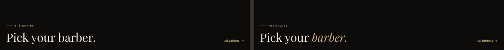
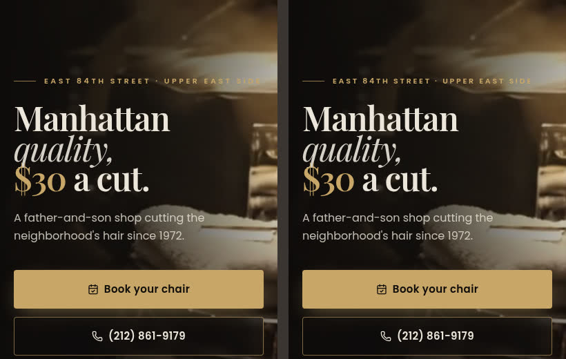
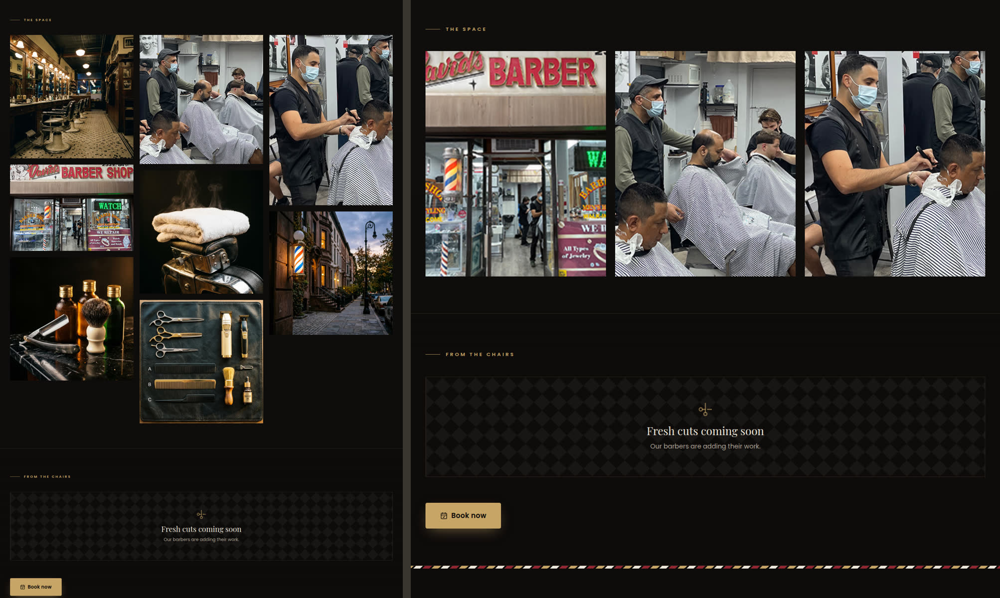
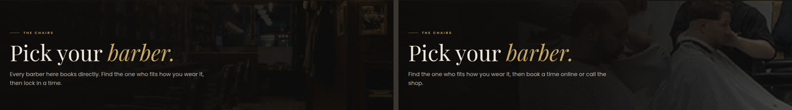
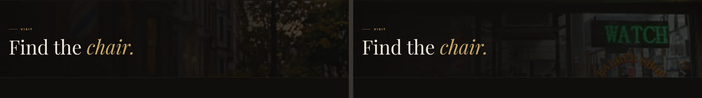
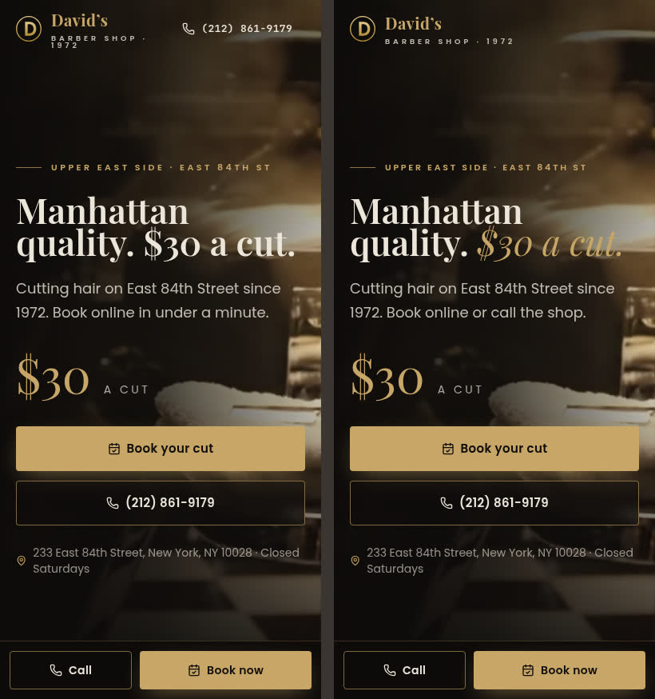
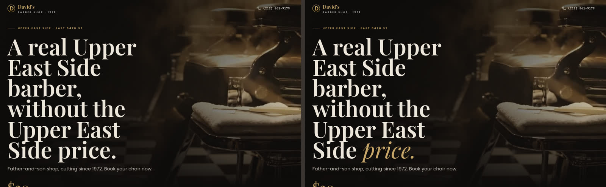

# Brand and content audit

_Run on 2026-11-03 (New York time). Every public route and every ad landing page was opened in a real browser (headless Chromium) at 1280 px and 402 px. Each was checked against `docs/brand/BRAND_GUIDE.md` and the content rules in `docs/DECISIONS.md`._

Before and after images are in `docs/audit/`. Each one shows **before on the left and after on the right**.

## 1. Sources of truth

### Google listing
Read in the browser at `https://www.google.com/maps?cid=3355011163649612090` and confirmed again by the live map embed on `/visit`. Screenshots: `audit/source-google-listing.jpg`, `audit/source-google-listing-hours.jpg`.

| Field | Google | Site | Match |
| --- | --- | --- | --- |
| Name | David's Barber Shop | David's Barber Shop | Yes |
| Address | 233 E 84th St, New York, NY 10028 | 233 East 84th Street, New York, NY 10028 | Yes |
| Phone | (212) 861-9179 | (212) 861-9179 / `+12128619179` | Yes |
| Website | davidsbarbershop84.com | sitemap and robots use davidsbarbershop84.com | Yes |
| Map link | CID 3355011163649612090 | every map link uses this CID | Yes |
| Rating | 4.7 (773 reviews) | not shown as a number on the site | n/a |
| Hours, Mon–Fri | 8:30 AM–7 PM | 8:30 AM–7 PM | Yes |
| Hours, Saturday | Closed | Closed | Yes |
| Hours, Sunday | 9 AM–6 PM | 9 AM–6 PM | Yes |

**Hours limitation.** The Google Maps API key is refused for this project. Places API (New) returns 403, the legacy Places API is not enabled, and Geocoding is not activated. The Google Maps connector can only search documentation, not place data. Signed out, Google Maps shows only today's row, and Google Search showed a captcha (`generated-artifacts/audit/google-search-panel.png`, not committed). So only Tuesday and Wednesday's opening time were confirmed against Google at the time of the audit. **Update 2026-11-03:** with the working Places key, the full week was read from the listing (regularOpeningHours): Mon–Fri 8:30 AM–7 PM, Saturday closed, Sunday 9 AM–6 PM. The table above shows that reading; every day matches the site.

### Booksy listing 1663005
Read in the browser. Screenshots: `audit/source-booksy-listing.jpg`, `audit/source-booksy-hours.jpg`.

| | Booksy | Site |
| --- | --- | --- |
| Staff | Michael, Russel, Alex | David (Owner), Sean |
| Haircut | $35 · 25 min | $30 · 30 min |
| Beard | $20 | not listed |
| Haircut & beard | $55 | not listed |
| Line up | $20 | not listed |
| Beard trim | $20 | Beard Trim $15 · 15 min |
| Not on Booksy | — | Shampoo & Cut $30, Crew Cut $22, Long Hair Cut $28, Royal Shave $25 |
| Hours | Sun 9–6, Mon 9–7, Tue–Thu 9:30–7, Fri 9–4:30, Sat closed | Mon–Fri 8:30–7, Sat closed, Sun 9–6 |
| Rating | 5.0 (1 review, for Michael) | — |

None of these were changed during the audit. They are owner decisions (see section 4).

**Update 2026-11-03:** the owner confirmed Booksy's menu and prices are correct. The site's services, durations and offer price now match Booksy exactly (the four services not on Booksy were removed). **Staff, 2026-11-03:** the owner confirmed Booksy's roster (Michael, Russel, Alex); the site now matches. **Hours, 2026-11-03:** the approved hours are the Google listing's (Mon–Fri 8:30–7, Sat closed, Sun 9–6), which the site already shows. Booksy's shorter weekday hours are for the owner to update in Booksy.

## 2. Page by page

Checks run on every page:
- **Brand:** colour tokens, Playfair + Poppins + JetBrains Mono, the plain + gold italic heading pattern, eyebrows with the gold rule, the pole rule above the footer, button styles, spacing, imagery.
- **Mobile:** layout at 402 px, including horizontal overflow (`scrollWidth` = 402 on every page after the fixes).
- **Accessibility and SEO:** alt text, title, description, robots, Open Graph image.

| Page | Checked | Fixed | Owner |
| --- | --- | --- | --- |
| **Home** `/` | Hero, marquee, story, barbers, menu, reviews, wall teaser, visit, final CTA, footer | "Pick your barber." now uses the gold italic accent. Marquee: removed "Kids' cuts" (not on the menu) and changed "Skin fades" to "Fades" (the menu doesn't list skin fades). Removed the five gold stars beside "From the chair": they implied a 5.0 rating, but Google shows 4.7. Hours card label is now a standard eyebrow. Eyebrow tracking is tighter at mobile width, so the hero eyebrow no longer runs to the screen edge. Menu buttons stack full width on mobile. | $30, roster |
| **Barbers** `/barbers` | Hero, cards, monograms | Removed the "Every barber here books directly" copy and meta description (booking goes through the shop's Booksy page). The hero image was a wood-panelled shop that isn't David's. It now shows a real photo of the shop. | Roster |
| **Profiles** `/barbers/david`, `/barbers/sean` | Name, bio, specialties, Booksy note, reviews | Sean's bio said clients come "to keep their standing appointment", which is not supported by the reviews. It now says "to keep their barber". Meta description is now cut at a word boundary. Share image uses the barber's photo when one exists. | David "Owner" / "The David in David's" unconfirmed; Sean not on Booksy |
| **Services** `/services` | Categories, rows, CTA | Book and Call buttons stack full width on mobile. | Prices vs Booksy |
| **Our Story** `/our-story` | Hero, 4-step timeline, images, CTA | Page title uses the founding year from settings (was hard-coded). | 1972 vs "84" |
| **Gallery** `/gallery` | Grid, alt text, empty state | "The space" mixed three real shop photos with five styled images captioned as if they were the shop ("Chairs and mirrors", "Barber pole at dusk"). It now shows only the three real photos, in an even grid. | Supply more real photos (Task #4 covers Google listing photos) |
| **Visit** `/visit` | Map, hours, phone, email, CTA | The hero image was a brownstone street with a pole, not the shop. It is now the real storefront. Meta description punctuation fixed ("Closed Saturdays. Call…"). Buttons stack on mobile. | Email domain (see 4) |
| **Privacy** `/privacy` | Copy, links | Title now uses the heading pattern ("Privacy *policy.*"). | — |
| **404** | Copy, buttons | `noindex` added. Primary Book button now comes first, matching every other CTA pair. | — |
| **`/l/30-dollar-cut` A** | Hero, prices, reviews, hours | Headline gets the gold italic accent ("Manhattan quality. *$30 a cut.*"). Subheadline said "Book online in under a minute", an unsupported claim. It now says "Book online or call the shop". Mobile header no longer wraps the wordmark; the phone number is in the bottom bar there. | $30 |
| **`/l/30-dollar-cut` B** | Same | Headline accent ("…without the Upper East Side *price.*"). | $30 |
| **`/l/book-david`, `/l/book-sean`** | Same, plus specialties and bio | Headline accent ("Book with *David.*"). On mobile, a faint monogram letter showed behind the price ("$30 A CUT D"). The placeholder portrait is now hidden on mobile when there is no photo. | Roster |
| **`/l/<unknown>`** | "Offer has closed up shop" | — (already correct, noindex) | — |

Site-wide:
- **Colour tokens:** Three off-token colours were replaced with named tokens. The gold button hover (`hsl(42 60% 68%)`) is now `gold-hover`; it is used on site buttons and in the booking sheet. The "Closed Saturdays" text colour (`hsl(354 60% 62%)`) is now `oxblood-text`, a lighter oxblood: true oxblood on ink is only about 2.4:1 contrast, too low for small text. The wall frame (`hsl(28 22% 9%)`) is now `card`. Both new tokens are added to the brand guide.
- **Eyebrows:** The footer's "Find us" and "Hours" labels now use the standard Eyebrow with the gold rule (they were bare caps).
- **Theme colour:** `theme-color` changed from `#0E0C0A` to `#0D0B0A` (Ink).
- **Open Graph:** The image was a relative path to the non-shop interior photo, which most link scrapers ignore. It is now an absolute 1600×900 hero still. Each page now also updates `og:url`, `og:image` and the Twitter title, description and image.
- **JSON-LD:**
  - Address, phone and map link match Google. The hours are the site hours, which match Google on the days that could be read.
  - `image` now points to the real storefront (`/media/storefront.jpg`) instead of the non-shop interior.
  - `sameAs` now includes the Booksy listing.
- **Sitemap:** Lists the seven indexable pages. Barber profiles were left out while the roster was unconfirmed; since 2026-11-03 the sitemap lists `/barbers/michael`, `/barbers/russel` and `/barbers/alex`. Landing pages stay `noindex` and are disallowed in robots.txt.
- **Alt text:** All content images have descriptive alt text. Decorative backgrounds use `alt=""`.
- **Copy rules:** No ethnic or religious descriptors were found. No player names appear (all wall entries are unpublished drafts). Reviews are verbatim, and "Best barbershop in NYC" appears only inside customer quotes.

### Before / after

| Fix | Image |
| --- | --- |
| Heading pattern, home barbers |  |
| Implied 5-star rating removed |  |
| Hero eyebrow spacing at 402 px |  |
| Gallery: real shop photos only |  |
| Barbers hero: real shop |  |
| Visit hero: real storefront |  |
| Landing A mobile: header, accent, copy |  |
| Landing B desktop: accent |  |
| Barber landing mobile: stray monogram, header |  |

## 3. How the copy fixes reach the live database

The seed only fills empty tables. Two corrections are therefore applied on API start, and only while a row still holds the exact old text, so admin edits are never overwritten:
- Sean's bio;
- the `30-dollar-cut` subheadline.

Both have been applied in development; production picks them up on its next start.

## 4. Owner decisions (not changed)

1. **Haircut price:** $30 on the site, $35 on Booksy (the old site said $25). Ads should not run until they match. **Resolved 2026-11-03:** owner confirmed $35; site updated.
2. **Menu:** Booksy lists Beard $20, Haircut & beard $55, Line up $20 and Beard trim $20. The site lists Beard Trim $15, plus four services that are not on Booksy. The haircut duration also differs (30 vs 25 min). **Resolved 2026-11-03:** the site's menu is now Booksy's.
3. **Roster:** the site shows David and Sean; Booksy now lists Michael, Russel and Alex. Confirm who works there, and whether David is the owner. **Resolved 2026-11-03:** the owner confirmed only Michael, Russel and Alex work there. The site now shows those three (Booksy staff IDs 1582201, 1869365, 1869419); David and Sean, and `/l/book-david`, `/l/book-sean`, are switched off, not deleted, so past bookings keep their barber. Booksy has no services assigned to Russel or Alex yet, so they cannot be booked online until the owner adds them.
4. **Hours:** Booksy says Tue–Thu open 9:30 and Fri close 4:30; the site says 8:30–7 on weekdays. Google confirms 8:30–7 on Tuesday and an 8:30 opening on Wednesday. The rest of the week is unverified against Google. **Resolved 2026-11-03:** the approved hours are the Google listing's, read in full through Places: Mon–Fri 8:30–7, Sat closed, Sun 9–6. The site already matched, so nothing on the site changed; the owner should update Booksy to the same hours.
5. **Founding year:** 1972, versus the "84" in the domain (likely the street, East 84th; owner to confirm).
6. **Email:** the site uses info@davidsbarbershop.com, a different domain from davidsbarbershop84.com. The Google listing has no email, so this could not be checked. Confirm the address receives mail.
7. **Photos:**
   - The styled images in `public/media/` (`interior.jpg`, `pole.jpg`, `tools.jpg`, `towel.jpg`, `clippers.jpg`) and the hero film are not photos of the shop.
   - They are now used only as background mood and as the share image (hero still), and are no longer presented as the shop.
   - The only real shop photos are three 349-px images from the old site. New photos are needed.
8. **Brand sign-off** on the guide and logo.

## 5. Not done / limits

- Hours for Mon, Thu, Fri, Sat and Sun were not confirmed against Google during the audit; done 2026-11-03 through Places (see 1).
- `og:image` in the static HTML points to `https://davidsbarbershop84.com/media/hero-poster.jpg`. Link previews will show it only after the DNS cutover; until then that domain serves the old site.
- Admin screens (outside this audit) still use a few raw HSL colours for success and danger text.
- `pnpm run typecheck` passes for the site and API. The `hero-loop` video artifact fails typecheck on its own (missing DOM lib); this predates the audit and was not changed.
- The 24 `landing_view` events created by opening landing pages during the audit were deleted.
